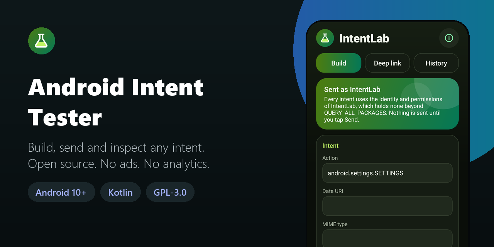
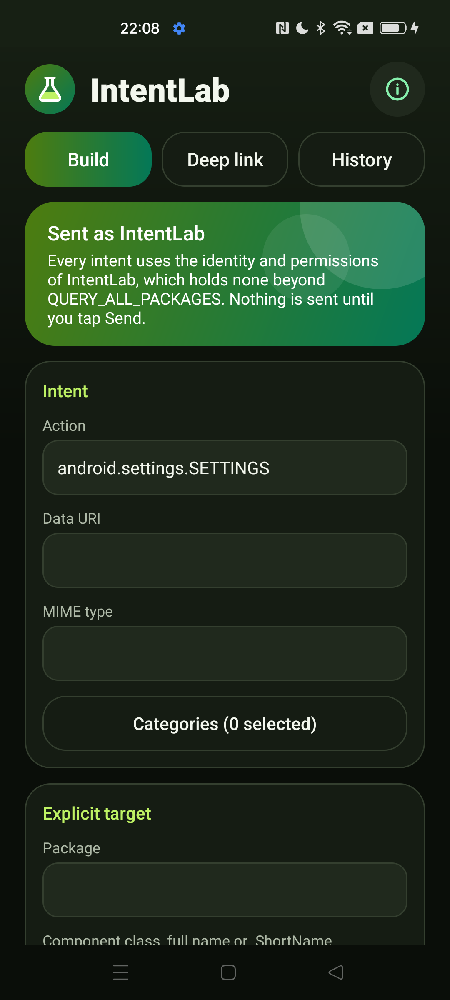
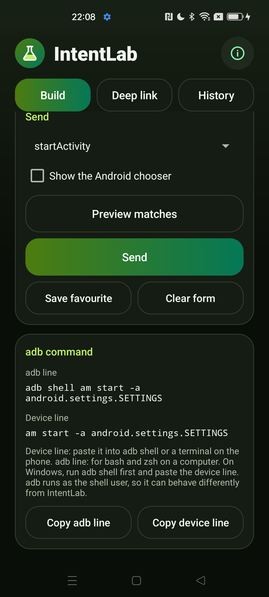
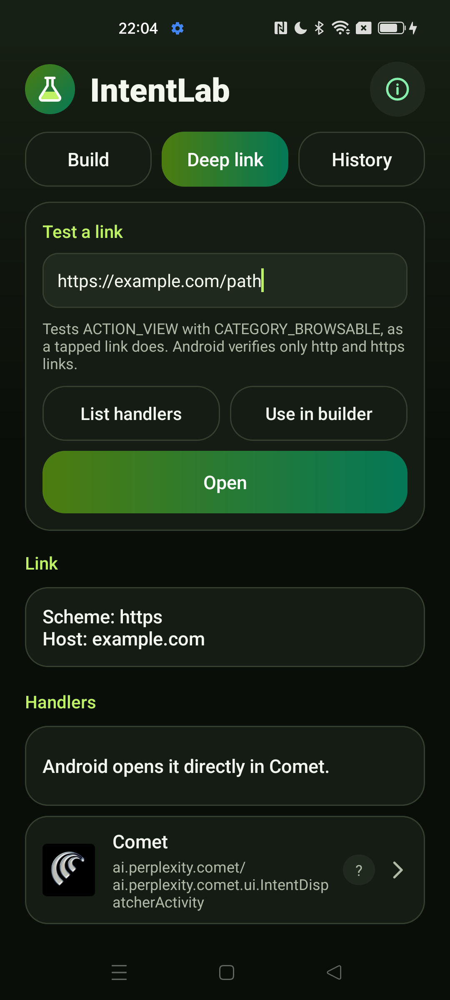
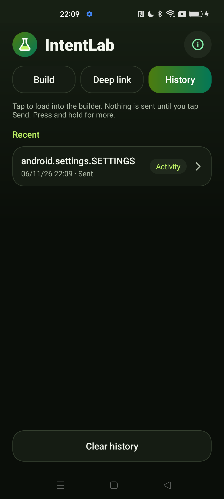

<div align="center">



# Android Intent Tester

**Build and fire intents and test deep links on your Android phone, without a PC. Open source, no ads, no analytics.**

[](LICENSE)
[](#requirements)
[](https://kotlinlang.org)
[](app/build.gradle.kts)
[](app/src/main/AndroidManifest.xml)
[](https://github.com/Nekuzaky/android-intent-tester/stargazers)

</div>

Android Intent Tester ships an app called **IntentLab**. It lets a developer build any intent by hand, see which components would match, send it, read the result and copy the equivalent `adb` command, all on the phone.

**Every intent is sent with the identity and permissions of IntentLab, which holds none beyond `QUERY_ALL_PACKAGES`.** It can do what any ordinary app can do, and Android refuses the rest.

## Screenshots

<p align="center">
  
  
  
  
</p>

## Features

- **Intent builder:** action with suggestions, data URI, MIME type, categories, explicit package or component, a checkbox list of common flags, and typed extras (string, int, long, boolean, float, double, string array)
- **Four ways to send:** `startActivity`, `startActivityForResult`, `sendBroadcast` and `startService`
- **Results:** the result code, data and extras of `startActivityForResult`, shown as plain text
- **Readable failures:** `ActivityNotFoundException`, `SecurityException` and every other failure appear as a message and do not crash the app
- **Resolve preview:** the activities, services and receivers that would match, with app and component name, marked when not exported or disabled, and with any permission they require
- **Chooser:** an option to send activity intents through the Android chooser
- **adb command:** the matching `am start`, `am broadcast` or `am startservice` command with correct shell quoting, ready to copy
- **Deep link tester:** paste a URL or custom scheme, list its handlers, see the app link verification state and open it
- **History and favourites:** recent intents and named favourites in private storage, editable in the builder, with a button to clear history
- No ads, no analytics, no account and no third-party libraries

## How it works

1. You fill in the builder. Nothing is sent until you tap **Send**.
2. IntentLab validates the fields and extras. An invalid value, such as `abc` for an int, blocks the send and is explained.
3. **Preview matches** asks Android which components match, using `MATCH_ALL` so that Android does not hide any result.
4. If the intent has a URI grant flag or a `content:` URI, a review dialog shows what would be granted, and to whom, before anything is sent.
5. The intent goes out through the normal public API and any failure is shown on screen.

### adb command

The app shows two lines, because `adb shell` passes its arguments through two shells:

| Line | Where to use it | Example |
| --- | --- | --- |
| **Device line** | Inside `adb shell` or a terminal on the phone | `am start -d 'https://e.com/?a=1&b=2'` |
| **adb line** | bash or zsh on a computer | `adb shell 'am start -d '\''https://e.com/?a=1&b=2'\'''` |

Without the outer quotes, the computer removes the inner quotes and the phone then treats `&` as a shell operator. On Windows, run `adb shell` first and paste the device line.

The command runs as the `shell` user and not as IntentLab, so it can succeed where the app is refused, or the other way round. The app warns when a command cannot match the intent exactly: `am` cannot request a result or show the chooser, and it keeps the backslash of an escaped comma in string arrays.

### Deep links

A deep link is tested as `ACTION_VIEW` with `CATEGORY_BROWSABLE`, as a tapped link is.

| Tag | Meaning |
| --- | --- |
| **Verified** | Android verified this app for the host |
| **User selected** | The user allowed this app for the host in settings |
| **Not verified** | The app declares the host, but it is not verified or selected |
| **Not declared** | The app has no verification entry for this host, for example a browser |
| **?** | Android did not share the state for this app |

The state comes from `DomainVerificationManager.getDomainVerificationUserState` for each handler and needs Android 12 or later. On Android 10 and 11, and for custom schemes, which Android does not verify, no state is shown.

## Security

- **Only the launcher activity is exported, and it reads nothing from its incoming intent.** Another app cannot fill in the form or trigger a send.
- **Every intent is built by you and sent only on an explicit tap.** Loading an entry from history or favourites only fills in the form.
- **No privileged actions are claimed.** IntentLab cannot do more than its own permissions allow.
- **URI access is never granted silently.** Selecting a `FLAG_GRANT_*_URI_PERMISSION` flag or sending a `content:` URI opens a review first.
- **Result extras are treated as hostile.** They are read with every error caught, including bad parcels and unknown classes, displayed only as text, limited in size, and stripped of control and bidi characters. Nothing in them is opened or acted on.
- **The labels and icons of other apps are treated as hostile.** Icons are drawn off the main thread into a fixed-size bitmap, with a fallback on any error. Labels are limited in length and cleaned.
- **Send buttons ignore touches while another window covers them,** using `filterTouchesWhenObscured`.
- **No `PendingIntent` is used.**

## Privacy

- No Internet permission and no analytics.
- History and favourites stay in the private storage of the app, with `allowBackup=false` and data extraction rules that exclude everything.
- IntentLab does not log intents. `FLAG_DEBUG_LOG_RESOLUTION` is left out of the flag list because it asks Android to write intents to the system log. Android itself can still log activity starts in that log.
- Text you copy goes to the system clipboard, and only when you tap **Copy**.

### Permissions

| Permission | Why it is needed |
| --- | --- |
| `QUERY_ALL_PACKAGES` | Android hides most installed apps from other apps without it. Resolve previews, handler lists and sends to a chosen app would then be incomplete or fail, and this is the purpose of the app. The list of apps stays on the phone |

## Requirements

- Android 10 (API 29) or later
- JDK 21 and Android SDK 35 to build from source

Gradle 8.11 does not support the Java 25 runtime bundled with recent Android Studio versions, so use a separate JDK 21.

## Download

Download the signed APK from the [latest release](https://github.com/Nekuzaky/android-intent-tester/releases/latest) and open it on your phone. Android may ask you to allow installs from the app you opened it with.

The release notes list the SHA-256 checksum of the APK and of its signing certificate.

## Build from source

A build signed with your own key cannot install over the release APK, so uninstall the app first.

```bash
git clone https://github.com/Nekuzaky/android-intent-tester.git
```

```bash
cd android-intent-tester
```

Create a `local.properties` file that points to your Android SDK:

```properties
sdk.dir=/path/to/Android/Sdk
```

Build a debug APK with JDK 21:

```bash
JAVA_HOME=/path/to/jdk-21 ./gradlew assembleDebug
```

To sign a release build, create a signing key and add a `keystore.properties` file at the project root. It is ignored by Git, so never commit it or your key. Without this file, `assembleRelease` still works and produces an unsigned APK.

```properties
storeFile=/path/to/your-key.jks
storePassword=your-password
keyAlias=release
keyPassword=your-password
```

```bash
JAVA_HOME=/path/to/jdk-21 ./gradlew assembleRelease
```

Install it on a phone with USB debugging enabled. The `--user 0` option keeps it out of any work profile:

```bash
adb install -r --user 0 app/build/outputs/apk/debug/app-debug.apk
```

Run the unit tests:

```bash
JAVA_HOME=/path/to/jdk-21 ./gradlew testDebugUnitTest
```

## Limitations

- **Your identity, not the system's.** Intents that need a permission IntentLab does not hold fail with a message, and protected broadcasts are refused.
- **Text extras only.** The builder has no Parcelable, URI or nested Bundle extras, so `EXTRA_STREAM` cannot be sent as a real URI.
- **Limited URI grants.** IntentLab can only pass on access it holds itself, and it has no content provider of its own.
- **Broadcast delivery is not visible.** Android does not report who received a broadcast, and most manifest receivers do not get implicit broadcasts since Android 8.
- **Background rules still apply.** Android can refuse or delay services and activities as it does for any app.
- **Verification state depends on Android.** If a version or brand refuses the query, the handler shows `?`.
- **Clipped results.** Results show up to 100 extras and 32,000 characters, and items beyond a limit are noted as cut.
- **Filtered touches.** While a screen filter or other overlay covers the app, Send buttons may not respond. Close the overlay to send.
- **Not suited to the Play Store.** `QUERY_ALL_PACKAGES` is restricted, so the app is meant to be installed directly.

## Test status

Unit tests for the current source: 79 pass. They cover shell quoting with malicious input, command generation, extras parsing with invalid values, the history format round trip and corrupt files, text cleaning, URI grant reviews, failure messages, result formatting and deep link parsing.

`assembleDebug` and `assembleRelease` with no signing key were built on Windows with JDK 21.

Tested with a debug build on one phone: Oppo Reno4 Z 5G, Android 12, ColorOS.

| Check | Result |
| --- | --- |
| Send `android.settings.SETTINGS` | Android settings opened, shown as Sent in history |
| Action with no handler | Shows `ActivityNotFoundException`, shown as Failed in history |
| Explicit target that is not exported | Shows `SecurityException`, no crash |
| Action with a space in it | Rejected before sending, with an error on the form |
| Deep link handlers for `https://example.com/path` | Listed, with the app Android would open |
| Link with no scheme | Rejected with an error |
| Direct launch of the internal screen from ADB | Refused |
| Typed action keeps its lowercase first letter | Works, after a fix for Gboard capitalizing it |
| Portrait and landscape screens read | No crash |
| Signed release build: install, send `android.settings.SETTINGS`, an intent with no handler | Settings opened, and the failure is shown with no crash |

Not tested: extras and URI grants on a phone, `startActivityForResult`, broadcasts and services, the verification state of app links, other brands, Android 10, 11, 13 and later, tablets, and work profiles. If something breaks on your phone, please open an issue.

## Related

- [Android Tracker Detector](https://github.com/Nekuzaky/android-tracker-detector): find the ad, analytics and tracking code inside your apps.
- [Android App Firewall](https://github.com/Nekuzaky/android-app-firewall): cut Internet access per app.
- [Android Permission Manager](https://github.com/Nekuzaky/android-permission-manager): see what every app can access.
- [Android App Duplicator](https://github.com/Nekuzaky/android-app-duplicator): run a second account of an app in a work profile.

## License

Distributed under the [GNU General Public License v3.0](LICENSE).
